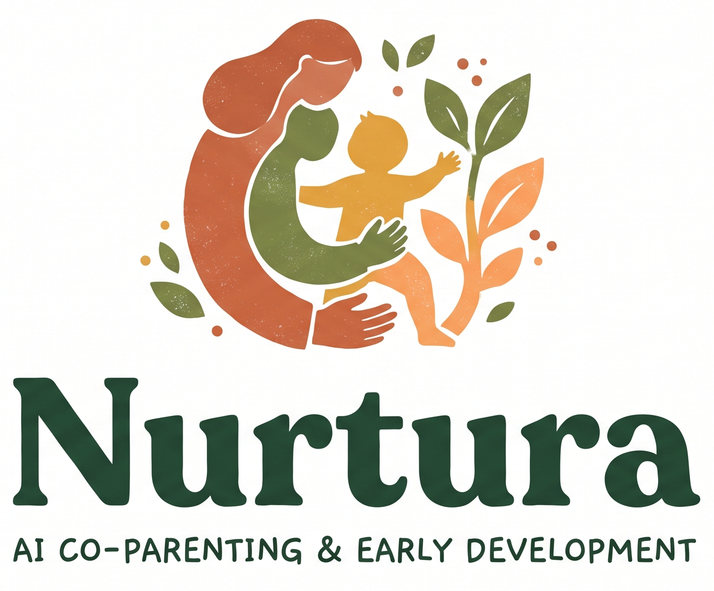

<table align="center">
  <tr>
    <td align="center" valign="middle">
      
    </td>
    <td align="center" valign="middle">
      
    </td>
  </tr>
</table>

<h1 align="center">Nurtura</h1>

<p align="center">
  <strong>An AI co-parenting companion for early childhood development and nutrition.</strong>
</p>

<p align="center">
  Built for the <strong>Google Cloud AI Builder Cup 2026</strong> · JAPAC
</p>

<p align="center">
  <a href="https://cloud.google.com/vertex-ai/generative-ai/docs/start/gcp-auth">Vertex AI</a>
  · <a href="https://www.cdc.gov/act-early/milestones/index.html">CDC milestones</a>
  ·   <a href="https://www.who.int/publications/i/item/9789241548403">WHO Care for Child Development</a>
</p>

## The one-line pitch

Nurtura turns a parent's everyday observation or meal photo into a grounded, age-aware next step: a clinical milestone interpretation, a three-day home activity plan, or a practical nutrition upgrade.

It is not a diagnosis engine. It is a structured decision-support experience that helps a parent notice, act, and know when to seek professional care.

## Why this matters

Parents often face a gap between clinical guidance and the next thing they can do at home:

- A milestone table can identify a concern but rarely explains what to try this afternoon.
- Developmental play is often presented as something that requires expensive toys or specialist equipment.
- Meal guidance can be hard to translate into texture, food-group balance, and a realistic next meal.

Nurtura addresses that gap with two focused workflows:

1. **Milestone & Daily Playbook** — interpret a natural-language observation against retrieved clinical guidance and produce a three-day, zero-cost activity plan.
2. **Smart Plate Vision** — inspect an uploaded meal image or selected food items, assess texture and nutrition signals, and suggest a practical next-meal improvement.

## What is live in this repository

### Module 1: Milestone & Daily Playbook

The parent provides:

- Child name, age in months, weight, and height.
- A natural-language observation.
- Optional milestone checks.

The backend retrieves relevant passages from the local clinical knowledge base, sends the child context and observation to Gemini through Vertex AI, validates the structured response with Pydantic, and returns:

- `ok`, `watch`, or `alert` status.
- A bilingual explanation and safety guidance.
- Retrieved grounding sources.
- A three-day playbook with household items and step-by-step activities.

The frontend renders only a successful live Gemini response. If the AI request fails, it shows an explicit error instead of silently replacing the result with demo content.

### Module 2: Smart Plate Vision

The parent can upload a meal photo or provide selected food items. The workflow returns:

- Detected foods and confidence signals.
- An age-aware texture assessment.
- Macro signals for animal protein, added fat, and carbohydrate.
- A next-meal upgrade.
- An optional five-minute booster recipe.

Image analysis is handled by Gemini's multimodal content generation path. The upload is sent to the FastAPI backend; the browser does not hold Vertex credentials.

## Design principles

### Useful before impressive

Every AI output must end in an action a parent can understand and try with ordinary household materials.

### Grounded, not authoritative

The application retrieves local clinical reference chunks and includes them in the model prompt. It presents the result as educational guidance, not a diagnosis or a substitute for a pediatric assessment.

### Structured by default

The model is asked for a strict JSON shape. FastAPI and Pydantic validate the response before it reaches the UI. This keeps the interface predictable and makes failures visible.

### Safe failure

There is no success-shaped fallback for live milestone analysis. An unavailable Vertex AI request returns an explicit `503` response, and the frontend does not label a sample as an AI assessment.

## Architecture

```text
Parent
  |
  | child profile, observation, or meal image
  v
Vue 3 + Vite single-page application
  |
  | REST: JSON and multipart/form-data
  v
FastAPI + Pydantic backend
  |
  | local retrieval from pediatric_rag_kb.md
  | system instruction + structured output contract
  v
Google Gen AI SDK
  |
  | Vertex AI / Gemini 3.8 Flash
  v
Validated bilingual result
  |
  +--> milestone status + RAG sources + three-day playbook
  +--> plate findings + texture verdict + next-meal upgrade
```

### Technology map

| Layer | Implementation | Responsibility |
| --- | --- | --- |
| Web app | Vue 3, Composition API, Vite, TypeScript | Responsive parent-facing experience |
| API | Python FastAPI | REST endpoints and multipart image handling |
| Validation | Pydantic v2 | Request and model-response contracts |
| AI runtime | Google Gen AI SDK on Vertex AI | Text and multimodal generation |
| Model | Gemini 3.8 Flash | Milestone reasoning, playbook generation, and meal-image analysis |
| Grounding | Lightweight local retrieval over `pediatric_rag_kb.md` | Age- and topic-relevant clinical context |
| Local persistence | Browser `localStorage` | Child profile, language, theme, and checklist state |
| Container target | Dockerfile for the backend | Reproducible API image |

Firebase is not required by the current implementation. Authentication, Firestore history, and permanent image storage are roadmap items rather than hidden dependencies.

## Grounding and safety

The current knowledge base is a curated local Markdown document indexed at backend startup. It covers CDC milestones and WHO/UNICEF Care for Child Development material used to ground the milestone workflow.

The model prompt requires:

- Developmental reasoning tied to the retrieved context.
- Clear, empathetic language.
- Age-aware activities using ordinary household objects.
- Safety guidance and escalation for meaningful concerns.
- Strict JSON output matching the API schema.

This product does not diagnose developmental delay, malnutrition, or any other medical condition. A parent should contact a qualified clinician for urgent concerns, loss of previously acquired skills, or persistent developmental worries. This approach is consistent with CDC guidance to act early and discuss concerns with a child's doctor.

## Run locally

### Prerequisites

- Python 3.12
- Node.js 24 or newer
- Google Cloud CLI
- A Google Cloud project with billing enabled
- Vertex AI API enabled for that project

### 1. Configure Vertex AI

From PowerShell:

```powershell
gcloud auth login
gcloud auth application-default login
gcloud config set project YOUR_PROJECT_ID
gcloud auth application-default set-quota-project YOUR_PROJECT_ID
gcloud services enable aiplatform.googleapis.com
```

The production-oriented local authentication method is Application Default Credentials. Do not commit a service-account key or an ADC file.

### 2. Configure the backend

```powershell
cd D:\Projects\ai-builder-nurtura\backend
Copy-Item .env.example .env
```

Set the following values in `.env`:

```env
USE_VERTEX_AI=True
GCP_PROJECT_ID=YOUR_PROJECT_ID
GCP_LOCATION=global
GOOGLE_CLOUD_PROJECT=YOUR_PROJECT_ID
GEMINI_MODEL=gemini-3.8-flash
GEMINI_TEMPERATURE=0.2
```

The backend reads credentials from ADC. `GEMINI_API_KEY` is intentionally empty when Vertex AI is enabled.

### 3. Start the backend

```powershell
cd D:\Projects\ai-builder-nurtura\backend
.\.venv\Scripts\Activate.ps1
uvicorn app.main:app --reload --port 8000
```

Useful endpoints:

| Endpoint | Purpose |
| --- | --- |
| `GET /api/v1/health` | Confirm service and Gemini configuration |
| `POST /api/v1/milestone/evaluate` | Live milestone analysis and playbook |
| `POST /api/v1/plate/audit` | Food selection and notes audit |
| `POST /api/v1/plate/audit-upload` | Meal image audit |

### 4. Start the frontend

```powershell
cd D:\Projects\ai-builder-nurtura\frontend
npm install
npm run dev
```

The Vite app defaults to:

```text
http://localhost:5173
```

To use a different API URL, create `frontend/.env.local`:

```env
VITE_API_BASE_URL=http://localhost:8000/api/v1
```

## Test and build

From the repository root:

```powershell
npm install
npm test
```

The root test command runs:

- Backend tests with `pytest`.
- Frontend type-checking and production build with `vue-tsc` and Vite.

The backend can also be tested directly:

```powershell
cd D:\Projects\ai-builder-nurtura\backend
.\.venv\Scripts\pytest.exe -q
```

## Containerization

The backend image is defined in [backend/Dockerfile](./backend/Dockerfile). Build it from the backend context:

```powershell
docker build -t nurtura-backend ./backend
docker run --rm -p 8000:8000 `
  -e USE_VERTEX_AI=True `
  -e GCP_PROJECT_ID=YOUR_PROJECT_ID `
  -e GCP_LOCATION=global `
  -e GOOGLE_CLOUD_PROJECT=YOUR_PROJECT_ID `
  nurtura-backend
```

In a hosted environment, prefer workload identity or the platform's attached service account over a JSON key. The image does not contain local `.env` files, ADC files, virtual environments, or test artifacts.

## Cloud Run deployment

The production topology uses two Cloud Run services in `asia-southeast1` (Singapore), the nearest Cloud Run region that supports managed custom domain mappings:

- `nurtura-frontend` serves the compiled Vue application through an unprivileged Nginx image.
- `nurtura-backend` runs FastAPI with the dedicated `nurtura-backend` service account and Vertex AI access.

The intended public endpoints are:

- `https://nurtura.web.id`
- `https://api.nurtura.web.id`

The frontend image is built with `VITE_API_BASE_URL=https://api.nurtura.web.id/api/v1`. Configure the Cloud Run domain mappings and the corresponding Cloudflare DNS records before using the custom domains. Keep Cloudflare proxying disabled while completing domain verification and certificate issuance; it can be enabled afterward if the Cloudflare TLS mode is set to **Full (strict)**.

The deployed services use cost guardrails: `min-instances=0`, `max-instances=2`, backend concurrency `10`, frontend concurrency `80`, bounded request timeouts, and a dedicated least-privilege backend service account. Billing budgets are alerts rather than hard spending caps, so monitor Vertex AI usage and Cloud Run requests separately.

## API contract

Milestone requests use a compact, explicit payload:

```json
{
  "child": {
    "name": "Bintang",
    "age_months": 18,
    "weight_kg": 11.2,
    "height_cm": 82.5
  },
  "observation_note": "Anak saya baru bisa bilang mama dan papa.",
  "checked_milestones": []
}
```

The response contract contains localized strings (`id` and `en`), a clinical status, safety guidance, retrieved RAG sources, and exactly three playbook days. A malformed or unavailable live response is surfaced as an error rather than converted into fabricated success data.

## Evaluation-ready strengths

| Judge concern | Evidence in the project |
| --- | --- |
| Clear user need | Converts passive concern into a small action plan |
| Google Cloud use | Vertex AI with Gemini 3.8 Flash and ADC |
| Multimodal capability | Meal image analysis through the plate workflow |
| Grounding | Retrieved local clinical chunks included in prompts and returned as sources |
| Reliability | Pydantic validation, explicit errors, tests, and deterministic UI states |
| Responsible AI | No diagnosis claim, red-flag guidance, and safe failure behavior |
| Accessibility of intervention | Household-object activities rather than paid equipment |
| Regional relevance | Indonesian parent context with Indonesian/English output |

## Roadmap

These are intentionally not represented as shipped features:

1. **Authenticated family accounts** with Firebase Authentication.
2. **Longitudinal history** for milestone and meal evaluations using Firestore.
3. **Secure image history** using object storage with retention controls.
4. **Posyandu and community mode** for consented, multi-child workflows.
5. **Audio observations** for parent-recorded language and babbling samples.
6. **Deployment automation** for Cloud Run and frontend hosting.

Each roadmap item requires a separate privacy, consent, access-control, and clinical-safety review before production use.

## Sources

- [Google Cloud: Authenticate for Gemini on Vertex AI](https://cloud.google.com/vertex-ai/generative-ai/docs/start/gcp-auth)
- [Google Cloud: Gemini inference reference](https://cloud.google.com/vertex-ai/generative-ai/docs/model-reference/inference)
- [CDC: Learn the Signs. Act Early. developmental milestones](https://www.cdc.gov/act-early/milestones/index.html)
- [WHO: Care for Child Development](https://www.who.int/publications/i/item/9789241548403)
- [WHO: Guideline for complementary feeding of infants and young children 6–23 months](https://www.who.int/publications/i/item/9789240081864)

## License and clinical notice

Nurtura is an educational prototype for the AI Builder Cup 2026. It is not medical advice, a diagnostic device, or a replacement for a pediatrician, dietitian, developmental specialist, or emergency service.

Before public deployment, review the applicable privacy, child-safety, data-retention, and healthcare requirements for each operating country.
